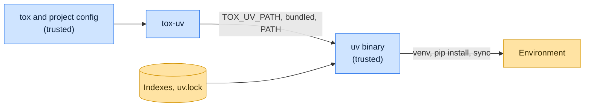

# Threat model

This model says what tox-uv trusts, where untrusted input enters, and which guarantees hold at each boundary, so a
report can be classified as a vulnerability or a bug. [SECURITY.md](SECURITY.md) covers reporting; if the two disagree,
SECURITY.md wins and we fix this file.

## How tox-uv works

tox-uv plugs into tox's environment and installer hooks. It locates `uv` from `TOX_UV_PATH`, the bundled `uv` package
(`tox-uv`), or `PATH` (`tox-uv-bare`), creates each environment with `uv venv`, and installs dependencies with
`uv pip install` or, for `uv-venv-lock-runner`, `uv sync` against `uv.lock`. It forwards the `UV_*` resolution variables
it lists (index URLs, constraints, `UV_EXCLUDE_NEWER` and so on) so uv resolves the same way inside tox.

## Compared with similar tools

We drew the boundary where comparable projects in other ecosystems draw theirs. The shared rule, stated by the
[Node.js threat model](https://github.com/nodejs/node/blob/main/SECURITY.md#the-nodejs-threat-model), is that a report
which first needs a trusted element compromised is out of scope; the first triage question, as
[DOMPurify](https://github.com/cure53/DOMPurify/blob/main/SECURITY.md#what-we-consider-a-vulnerability) puts it, is what
the attacker controls.

| Project                                                              | Language   | Where it draws the line                                                                                                                                |
| -------------------------------------------------------------------- | ---------- | ------------------------------------------------------------------------------------------------------------------------------------------------------ |
| [uv](https://github.com/astral-sh/uv/security/policy)                | Rust       | The installer tox-uv drives; resolution and download integrity are its responsibility.                                                                 |
| [Vitest](https://github.com/vitest-dev/vitest/security/policy)       | JavaScript | Trusts the developer, their machine, the config file, plugins and every project file; a report counts only if it needs no trusted element compromised. |
| [Lefthook](https://github.com/evilmartians/lefthook/security/policy) | Go         | Runs the commands its configuration names by design; that is not a vulnerability.                                                                      |
| [Hatch](https://github.com/pypa/hatch/security/policy)               | Python     | Assumes the user has full control over the build environment.                                                                                          |

## Trusted

An attacker who controls any of these already has what tox-uv could give them:

- Everything tox trusts: the user, the project configuration and installed plugins.
- The uv binary it selects and uv's configuration files and `UV_*` variables.
- The configured indexes and `uv.lock`.

## Untrusted inputs

| Input                    | Comes from                       | What tox-uv guarantees                                                                                       |
| ------------------------ | -------------------------------- | ------------------------------------------------------------------------------------------------------------ |
| The `uv` binary location | `PATH` order on a shared machine | `TOX_UV_PATH` and the bundled `uv` win over `PATH`; a `TOX_UV_PATH` choice is logged with its version.       |
| Lock state               | `uv.lock` in the project         | `uv sync` runs with `--locked` unless `uv_sync_locked = false` or frozen mode is set, so a stale lock fails. |

## Threats and controls

| STRIDE    | Threat                                                                  | Control                                      |
| --------- | ----------------------------------------------------------------------- | -------------------------------------------- |
| Spoofing  | A different `uv` on `PATH` is used though the bundled one is installed. | The bundled binary is preferred over `PATH`. |
| Tampering | Installs ignore the lock and pull newer versions.                       | `--locked` by default.                       |

## Release chain

Releases run on the shared [tox-dev/github-workflows](https://github.com/tox-dev/github-workflows) pipeline. A release
App, not a person, pushes the release commit and tag; the build installs its tools hash-checked from `pylock.toml` with
a seven-day upload cooldown; PyPI receives the files through
[trusted publishing](https://docs.pypi.org/trusted-publishers/) with attestations, and the GitHub Release is immutable.
Every workflow pins third-party actions to a commit SHA.

## Vulnerability or bug

| Report                                                         | Verdict             | Why                                                |
| -------------------------------------------------------------- | ------------------- | -------------------------------------------------- |
| tox-uv runs `uv` from `PATH` while `TOX_UV_PATH` names another | Vulnerability       | Selection order is a guarantee.                    |
| A malicious package on the configured index installs           | Not a vulnerability | Index content is trusted; use locks and cooldowns. |
| uv mis-resolves a marker                                       | Not ours            | Report it to uv.                                   |

## Accepted risks

- `tox-uv-bare` trusts whatever `uv` is first on `PATH`.

## Keeping this current

Revisit this model when tox-uv gains a new input source, network access, a new way to run code, or a new place it writes
to, and whenever an advisory is published.
